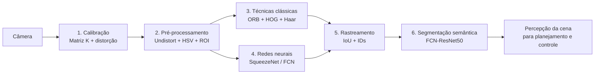
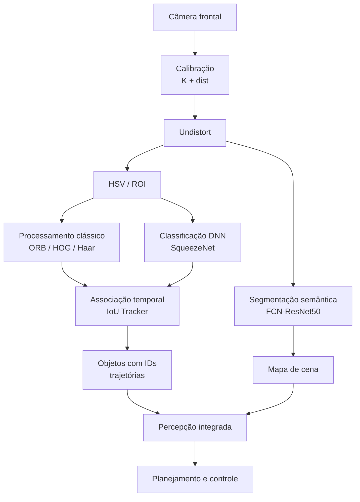

# Relatório Técnico Integrativo — Pipeline de Percepção Visual para Veículos Autônomos

Este relatório consolida os procedimentos implementados nos quatro exercícios da avaliação, organizando-os em um pipeline de percepção visual voltado à aplicação em veículos autônomos urbanos. As métricas apresentadas foram extraídas dos códigos, arquivos de saída e execuções reproduzíveis disponíveis no material entregue. Quando determinado valor é uma referência definida pelo próprio código, uma estimativa ou uma condição de teste sintética, isso é explicitamente indicado. Essa distinção é necessária para evitar que resultados de referência sejam interpretados como medições experimentais de desempenho real.

---

## 1. Diagrama do Pipeline Completo

O pipeline pode ser organizado em seis estágios principais: calibração, pré-processamento, detecção clássica, classificação/detecção baseada em redes neurais, rastreamento e segmentação semântica. Embora os exercícios não implementem um único sistema contínuo de produção, suas técnicas podem ser integradas conceitualmente em uma arquitetura de percepção para um veículo autônomo.



### 1.1 Calibração da câmera

O Exercício 1 utiliza um padrão sintético de tabuleiro de xadrez com **7 × 6 pontos internos**, imagens de **1280 × 720 pixels** e 18 posições diferentes da câmera. A calibração é realizada com `cv2.calibrateCamera`, produzindo a matriz intrínseca, os coeficientes de distorção e os parâmetros de pose de cada observação.

Na execução reproduzida, a matriz estimada foi:

```text
K =
[[902.0665,   0.0000, 640.5846],
 [  0.0000, 912.4566, 360.6421],
 [  0.0000,   0.0000,   1.0000]]
```

Os valores de referência utilizados na geração das imagens eram `fx = 900`, `fy = 910`, `cx = 640` e `cy = 360`. O erro médio de reprojeção obtido foi de **0,1263 px**, com erros individuais entre aproximadamente **0,0753 px e 0,2418 px**. O resultado demonstra boa consistência geométrica dentro do ambiente sintético utilizado.

A calibração também é reutilizada para `cv2.undistort` e para a etapa de realidade aumentada, na qual o código utiliza `solvePnP` e `projectPoints` para estimar a pose do padrão e projetar um cubo tridimensional sobre a imagem.

### 1.2 Pré-processamento

O segundo estágio reúne operações de baixo nível destinadas a preparar a imagem para os métodos posteriores. O pipeline integrado do Exercício 2 executa, em sequência, `undistort`, segmentação HSV, extração de características ORB, detecção HOG/Haar e classificação por rede neural.

Em uma execução reproduzida sobre o quadro sintético fornecido, foram obtidos os seguintes tempos: **6,54 ms** para `undistort`, **4,80 ms** para HSV, **3,28 ms** para ORB, **184,75 ms** para HOG/Haar e **45,75 ms** para a classificação DNN. O tempo total foi de **245,12 ms** por quadro. Como se trata de uma execução de um único quadro, esses valores devem ser interpretados como uma medição pontual, e não como um benchmark estatístico completo.

### 1.3 Técnicas clássicas

O material utiliza ORB para extração de características locais, HOG com SVM pré-treinado para detecção de pessoas e Haar Cascade para detecção facial. Essas técnicas possuem menor complexidade de implementação e não dependem necessariamente de aceleradores de IA, mas apresentam limitações relacionadas à escala, iluminação, oclusões e variedade das cenas.

### 1.4 Redes neurais

O Exercício 2 utiliza SqueezeNet 1.1 em formato ONNX por meio do OpenCV DNN para classificação. O Exercício 4 utiliza FCN-ResNet50 pré-treinada para segmentação semântica. O Exercício 3 contém uma estrutura preparada para YOLOv8n e SSD MobileNetV2, porém os pesos desses modelos não estão presentes no arquivo entregue; por isso, os scripts possuem um modo de detecção sintética para execução sem os modelos externos.

### 1.5 Rastreamento

O Exercício 3 implementa um rastreador baseado em IoU, com limiar de associação de **0,30**, tolerância de até **8 frames ausentes** e trilhas com comprimento máximo de **30 frames**. O rastreador mantém IDs persistentes e associa as detecções entre quadros consecutivos.

### 1.6 Segmentação semântica

O Exercício 4 implementa inferência com FCN-ResNet50 e produz sobreposições semitransparentes das classes previstas. Entretanto, as imagens de entrada são cenas sintéticas produzidas pelo próprio código, e as máscaras didáticas utilizadas como referência não correspondem diretamente às 21 classes Pascal VOC do modelo FCN. Portanto, não é metodologicamente correto apresentar as porcentagens das máscaras sintéticas como acurácia ou mIoU da rede.

---

## 2. Tabela Comparativa das Técnicas Estudadas

A tabela seguinte consolida as métricas que podem ser sustentadas pelos arquivos e pelas execuções disponíveis.

| Etapa | Técnica | Velocidade / Métrica | Qualidade / Indicador | Complexidade | Observação |
|---|---|---:|---|---|---|
| Calibração | `calibrateCamera` | — | **0,1263 px** de erro médio | Baixa, offline | 18 imagens sintéticas |
| Pré-processamento | `undistort` | **6,54 ms** | — | Baixa | Execução pontual |
| Pré-processamento | HSV | **4,80 ms** | ROI por cor | Baixa | Quadro sintético |
| Clássica | ORB | **3,28 ms** no pipeline | Características locais | Baixa | Até 250 features |
| Clássica | HOG + Haar | **184,75 ms** combinados | Detecções de pessoas/rostos | Média | Execução pontual |
| DNN | SqueezeNet/OpenCV DNN | **9,22 ± 1,82 ms** | Top-3 gerado para 10 imagens | Média | Benchmark local |
| DNN | SqueezeNet | **108,4 FPS** | Modelo de **4,7 MB** | Média | OpenCV DNN |
| DNN | Keras/MobileNetV2 | **44,80 ms** | 22,3 FPS | Média/alta | Valor de referência quando TensorFlow não estava instalado |
| Rastreamento | IoU Tracker | — | **4 IDs criados / 0 removidos** em 6 s | Baixa | Cenário sintético |
| Segmentação | FCN-ResNet50 | — | Máscaras e overlays gerados | Alta | Sem mIoU medido |
| Segmentação | Máscara sintética | — | Classes didáticas por área | Baixa | Gabarito das cenas, não desempenho da rede |

### 2.1 Classificação com SqueezeNet

O Exercício 2 processa dez imagens de teste e gera resultados Top-3. O arquivo `labels_top1.csv`, entretanto, não possui rótulos esperados preenchidos. Consequentemente, não há base para calcular uma acurácia experimental própria sobre essas dez imagens. Na execução reproduzida, as dez imagens receberam `iPod` como primeira classe, evidenciando que o resultado deve ser interpretado com cautela e não como uma validação semântica correta dos objetos presentes.

A latência medida para o OpenCV DNN foi de **9,22 ± 1,82 ms**, correspondente a aproximadamente **108,4 FPS** em uma chamada isolada de inferência. O processo apresentou aproximadamente **157,7 MB de memória residente**, enquanto o arquivo ONNX possui aproximadamente **4,7 MB**.

O código também apresenta **92,4%** para OpenCV DNN e **92,8%** para Keras como valores de Top-1 ImageNet. Esses números são constantes declaradas no próprio script e não foram calculados a partir das dez imagens da atividade. Portanto, são referências de benchmark utilizadas pelo programa, e não métricas experimentais da base fornecida.

### 2.2 Pipeline integrado

A execução do pipeline integrado demonstra um ponto importante para sistemas robóticos: uma aplicação composta por várias etapas não deve ser avaliada apenas pelo custo isolado de cada algoritmo. O conjunto `undistort + HSV + ORB + HOG/Haar + DNN` apresentou **245,12 ms** no quadro utilizado, equivalente a aproximadamente **4,08 FPS** se todas as etapas fossem executadas sequencialmente em todos os quadros.

Esse resultado mostra que as técnicas leves podem ser combinadas com baixo custo, enquanto a etapa HOG/Haar e a inferência DNN concentram parcela relevante do tempo. Em uma arquitetura embarcada, seria possível executar algumas operações em frequência menor ou restringir sua área de processamento.

### 2.3 Detecção e rastreamento no Exercício 3

O código do Exercício 3 define um vídeo sintético de **120 frames**, resolução de **960 × 540 pixels** e taxa nominal de **20 FPS**, correspondendo a seis segundos de vídeo. O cenário contém objetos sintéticos das classes `person`, `car`, `bicycle` e `bus`, com posições e movimentos definidos matematicamente.

Os modelos YOLOv8n e SSD MobileNetV2 são suportados pelo código, mas seus arquivos de pesos não fazem parte do material entregue. Na ausência dos modelos, os scripts executam `fake_detector`, seguido de NMS. Assim, valores de velocidade de inferência de modelos reais não podem ser atribuídos ao material sem uma execução com os respectivos pesos.

Na execução sintética reproduzida, o rastreador manteve **4 IDs criados**, nenhum ID removido e nenhuma saída contabilizada durante os seis segundos. A expressão `switches_por_minuto` do código utiliza `tracker.total_created`, portanto ela representa, na prática, uma taxa de criação de IDs, e não uma medição independente de ID switches. Esse detalhe é relevante para a interpretação dos resultados.

---

## 3. Viabilidade em Hardware Embarcado com Restrição de 5 W

O limite de 5 W é uma restrição de projeto e não foi medido diretamente nos exercícios. Nenhum código do material realiza medição de potência elétrica em watts. Portanto, a análise deve utilizar latência, tamanho de modelo e frequência de processamento como indicadores indiretos.

| Técnica | Evidência disponível | Consideração para 5 W |
|---|---|---|
| HSV | 4,80 ms no pipeline integrado | Baixo custo relativo; adequada para processamento frequente |
| ORB | 3,28 ms no pipeline integrado | Pode ser utilizado em frequência elevada, dependendo da resolução |
| `undistort` | 6,54 ms no pipeline | Custo moderado e previsível |
| HOG/Haar | 184,75 ms combinados | Deve ser restringido a ROIs ou executado em baixa frequência |
| SqueezeNet/OpenCV DNN | 9,22 ms | Custo compatível com aplicações que disponham de CPU adequada, mas depende do hardware-alvo |
| FCN-ResNet50 | Sem medição registrada | Rede significativamente mais complexa; requer benchmark específico |
| IoU Tracker | Operação baseada em caixas | Baixo custo computacional relativo |
| YOLOv8n/SSD | Sem pesos no material | Não há medição válida de consumo ou latência real |

A principal estratégia para um dispositivo limitado a 5 W consiste em separar o processamento por frequência. Operações como correção geométrica, segmentação simples e rastreamento podem atuar continuamente, enquanto redes mais pesadas podem ser executadas periodicamente ou somente quando houver necessidade de atualização da percepção.

A quantização, redução de resolução e uso de regiões de interesse também são estratégias pertinentes, mas devem ser tratadas como propostas de otimização, pois não foram medidas neste trabalho. Da mesma forma, a utilização de NPU, GPU, DSP ou outro acelerador depende do hardware escolhido e não pode ser considerada uma característica já comprovada pelo experimento.

---

## 4. Proposta de Arquitetura de Percepção para Veículo Autônomo Urbano

A partir das técnicas efetivamente implementadas, propõe-se a seguinte organização:



A calibração deve permanecer como uma etapa inicial de configuração do sistema. Durante a operação, `undistort` corrige cada quadro antes das demais análises. O HSV pode atuar como filtro inicial para localizar regiões de interesse, reduzindo a quantidade de pixels processados por técnicas mais custosas.

O ORB pode fornecer características locais para tarefas de correspondência e localização relativa. O HOG e o Haar devem ser considerados componentes especializados, uma vez que sua utilização combinada apresentou custo elevado no pipeline integrado. A classificação por SqueezeNet demonstra que modelos compactos podem ser utilizados por meio do OpenCV DNN, mas a classificação não substitui um detector de objetos quando são necessárias localização e identificação simultâneas.

Para o rastreamento, o IoU Tracker pode receber as caixas produzidas pelos detectores e preservar IDs entre quadros. A implementação atual não possui um modelo explícito de movimento, portanto uma evolução natural seria integrar um filtro de Kalman ou outro estimador de estado para lidar com pequenas perdas de detecção e oclusões.

A FCN-ResNet50 pode complementar as caixas delimitadoras com informação densa por pixel. Contudo, antes de utilizar essa etapa em um sistema embarcado, seria necessário medir a latência real, consumo de memória e consumo energético no hardware-alvo. Uma alternativa de engenharia seria avaliar uma arquitetura de segmentação mais compacta caso os requisitos de tempo real sejam rígidos.

---

## 5. Lacunas a Serem Endereçadas na DR4 — Veículos Autônomos e Robótica Móvel

### Lacuna 1 — Rastreamento robusto de identidades

O rastreador implementado utiliza somente IoU para associação. Essa abordagem é adequada para demonstrar o conceito de identidade persistente, mas não modela explicitamente velocidade, aceleração, aparência ou oclusão. A DR4 pode ampliar o método utilizando filtro de Kalman para predição de posição e algoritmos de associação mais robustos, como uma combinação entre custo geométrico e distância de movimento.

### Lacuna 2 — Profundidade e localização espacial

A calibração realizada no Exercício 1 fornece parâmetros intrínsecos e possibilita estimativas geométricas, mas não fornece por si só a distância métrica de cada objeto observado. Um sistema autônomo precisaria incorporar visão estéreo, sensores de profundidade, LiDAR, radar ou técnicas de estimativa de profundidade monocular. A integração dessas informações permitiria transformar caixas 2D em representações espaciais mais úteis para planejamento.

### Lacuna 3 — Integração entre percepção, predição e controle

Os exercícios concentram-se na percepção visual. Ainda não há implementação de estimativa de velocidade de objetos, tempo até colisão, predição de trajetórias, planejamento de caminho ou controle dos atuadores. A evolução para a DR4 deve fechar o ciclo entre percepção, predição, planejamento e controle, mantendo requisitos explícitos de latência e segurança.

### Lacuna 4 — Validação em dados reais

Grande parte dos experimentos deste material utiliza dados sintéticos. Isso facilita a reprodutibilidade e permite controlar as variáveis, porém não reproduz integralmente iluminação variável, sombras, ruído de sensores, oclusões, texturas complexas e comportamento imprevisível de agentes reais. Uma etapa posterior deve utilizar vídeos e imagens reais, mantendo uma separação entre dados de desenvolvimento e dados de validação.

---

## 6. Limitações e Métricas Não Medidas

As limitações abaixo são parte essencial da interpretação dos resultados:

- **Consumo energético:** não houve medição em watts. A discussão sobre 5 W é uma análise de engenharia baseada em latência e complexidade, não uma medição elétrica.
- **YOLOv8n e SSD MobileNetV2:** os arquivos de pesos não estão presentes no material. Os scripts possuem caminhos para os modelos e fallback sintético. Portanto, não é possível atribuir aos arquivos entregues uma latência real de inferência desses modelos.
- **Segmentação semântica:** o Exercício 4 gera cinco cenas sintéticas de 960 × 540 pixels e suas máscaras didáticas. As áreas médias das classes presentes nas máscaras são aproximadamente: céu **33,13%**, pista **26,77%**, calçada **32,63%**, vegetação **1,26%**, veículo **3,56%**, pedestre **1,80%** e faixa **0,86%**. Esses valores descrevem o gabarito das cenas, não a qualidade da FCN-ResNet50.
- **FCN-ResNet50:** o código utiliza pesos pré-treinados e classes Pascal VOC. As máscaras sintéticas usam uma taxonomia didática diferente. Sem uma etapa formal de correspondência entre as classes, não há base para calcular IoU ou mIoU diretamente.
- **Classificação DNN:** o CSV de rótulos esperados possui os campos de classe sem preenchimento. Assim, as dez imagens não permitem calcular uma acurácia experimental própria.
- **Keras:** no ambiente de verificação, TensorFlow não estava instalado. O valor de **44,80 ms** utilizado pelo código é um benchmark de referência definido como fallback, enquanto os **9,22 ms** do OpenCV DNN foram efetivamente medidos.
- **Top-1 ImageNet:** os valores de **92,4%** e **92,8%** são constantes inseridas no script para comparação de referência e não representam acurácia calculada sobre as dez imagens da atividade.
- **Rastreamento:** a variável apresentada pelo programa como `switches_por_minuto` é calculada a partir do número total de IDs criados. Portanto, ela deve ser interpretada como taxa de criação de IDs, não como uma métrica convencional de ID switches.
- **Benchmark do pipeline:** os **245,12 ms** foram obtidos em uma execução pontual sobre um quadro sintético. Para uma conclusão estatística seria necessário executar múltiplos frames e apresentar média, desvio-padrão e, idealmente, percentis de latência.
- **Hardware:** as medições realizadas neste trabalho não constituem uma caracterização universal de desempenho. A latência depende da CPU, memória, resolução, versão das bibliotecas e backend utilizado.

---

## Conclusão

O conjunto de exercícios demonstra a construção progressiva de um pipeline de percepção visual, partindo da calibração geométrica e chegando à classificação, detecção, rastreamento e segmentação semântica. A calibração apresentou erro médio de reprojeção de **0,1263 px** nas imagens sintéticas utilizadas, enquanto o pipeline integrado do Exercício 2 evidenciou o impacto da composição de múltiplas técnicas, alcançando **245,12 ms** em uma execução de referência.

Os resultados também mostram que a avaliação de um sistema de visão computacional deve considerar não apenas a qualidade da saída, mas também a procedência das métricas, o custo computacional e as condições de teste. No caso da classificação, por exemplo, a ausência de rótulos esperados preenchidos impede o cálculo de uma acurácia experimental própria. No caso da detecção do Exercício 3, a ausência dos pesos dos modelos faz com que a execução reproduzível disponível utilize dados sintéticos. Na segmentação, as máscaras geradas representam um gabarito controlado das cenas e não constituem uma avaliação direta da FCN-ResNet50.

Para uma arquitetura embarcada com restrição energética, a integração por níveis de frequência constitui uma estratégia coerente: operações de baixo custo podem atuar continuamente, enquanto modelos mais complexos são acionados de maneira seletiva. Entretanto, a validação definitiva dessa arquitetura depende de medições realizadas no hardware-alvo, incluindo latência, memória, consumo elétrico e qualidade das previsões em dados reais.

Como continuidade para a DR4, destacam-se quatro frentes: aprimoramento do rastreamento com modelo de movimento, obtenção de profundidade métrica, validação em ambientes reais e integração da percepção com predição, planejamento e controle. Dessa forma, o trabalho evolui de um conjunto de experimentos independentes para uma arquitetura de percepção mais próxima dos requisitos de um sistema robótico autônomo.
